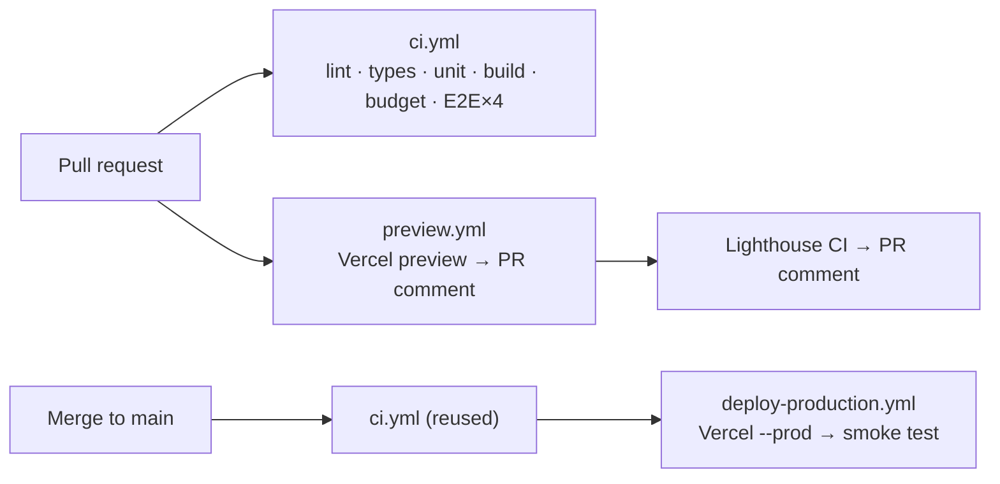

# MANIFESTO.md

An editorial, single-page personal manifesto written in plain-text Markdown and rendered as a quiet, cinematic web experience. Built with **Vite**, **React**, **TypeScript**, **Tailwind CSS v4**, **Framer Motion**, and **Lenis**.

---

## Features & Page Choreography

1. **Page-Load Preloader (`Preloader.tsx`)**
   - Eased monospace counter (`000 → 100%`) with a matching accent hairline followed by a vertical curtain lift (`y: 0% → -100%`) synchronized with the hero entrance.
2. **Full-Viewport Hero (`Hero.tsx` + `TypedLine.tsx`)**
   - `100dvh` opening plate on `#201e1f` with author/date metadata (top-left) and a `Skip to the text` jump link to `#read` (top-right).
   - Giant `"HUMAN.md"`-style display title (`Instrument Serif`, up to `~12vw`) with a `60ms` letter-by-letter masked upward reveal (`ease-out expo`).
   - Three sequential Markdown blockquote subtitles (`>` in warm orange) typed out terminal-style via a reusable `<TypedLine />` component with zero layout shift.
   - Centered `scroll` cue with a looping downward hairline animation.
3. **Pinned Statement Sequence (`StatementSequence.tsx`)**
   - `300dvh` scroll container with a pinned `100dvh` stage scrubbing six huge-type statements (`opacity: 0 → 1`, `y: 40 → 0`, `blur(8px) → 0`), paired with a vertical left-edge scroll progress bar and `01 / 06` index.
4. **Full-Bleed Image Transition (`FullBleedTransition.tsx`)**
   - `220dvh` pinned transition scaling a photograph from `1.15 → 1` while expanding `clip-path` from `inset(15% 10% round 12px)` to `inset(0)` behind a centered monospace `## the actual (human) job` heading.
   - Served via `<picture>` (WebP + progressive JPEG fallback) with lazy loading and explicit dimensions.
5. **Data-Driven Reading Section (`ReadingSection.tsx` + `src/data/manifestoItems.ts`)**
   - Two-column desktop layout (collapsing to one column on mobile): sticky left outlined numeral (`-webkit-text-stroke`) that crossfades as the active item changes, paired with `62ch` editorial prose on the right.
   - Ten structured items supporting inline `*italics*`, `` `code` ``, custom accent `–` bullet lists, and short line-broken lists.
   - `IntersectionObserver` scroll reveals: titles type in (`### 1. title` with dimmed hashes), body blocks fade up with `80ms` stagger, and `1px` dividing rules draw left-to-right on entry.
   - Sticky mini table-of-contents (`1–10` dots) on the right edge (and compact sticky bar on mobile) with smooth Lenis scrolling.
6. **Two-Column Closing, Sign-Off & Oversized Wordmark (`ClosingSection.tsx` + `Footer.tsx`)**
   - `## things I am trying to stop doing` (multi-line left-to-right animated strikethrough on view) alongside `## things I am trying to do more` (animated SVG checkmark `pathLength: 0 → 1`).
   - Centered serif disclaimer, italic signature, `last touched` stamp, and contact email link, finished by an oversized footer wordmark that slides up out of a baseline mask.
7. **Editorial Polish & Inspection**
   - **Fixed minimal header** with a `field index [+]` trigger opening a full-screen section overlay (`IndexOverlay.tsx`) via a `clip-path` circle wipe originating from the button's exact screen coordinates.
   - **Editorial / Raw `.md` toggle** (`RawMarkdownView.tsx`, lazy-loaded) rendering the exact serialized Markdown source with line numbers and one-click copy.
   - **Custom cursor** (`CustomCursor.tsx`): dot + spring-trailing ring that expands over links and displays `"read"` over `#read` (automatically disabled on touch devices and reduced motion).
   - **Hover-draw links** (`HoverLink.tsx`), **2px top reading progress bar** (`ReadingProgress.tsx`), and a **4% opacity SVG fractal-noise film grain overlay** (`FilmGrain.tsx`).

---

## Design Tokens

All tokens live in [`src/styles/tokens.css`](src/styles/tokens.css) and are bridged into Tailwind v4 via `@theme` in [`src/styles/global.css`](src/styles/global.css).

| Token | Value | Role / Contrast |
| --- | --- | --- |
| `--color-bg` | `#201e1f` | Warm near-black canvas |
| `--color-bg-elevated` | `#282527` | Cards, raw source viewer, inline code |
| `--color-text` | `#f2eee8` | Primary off-white ink (`14.34:1` AAA) |
| `--color-text-secondary` | `#b8b1a7` | Body prose (`7.80:1` AAA) |
| `--color-text-muted` | `#968f86` | Meta, indices, labels (`5.19:1` AA) |
| `--color-accent` | `#f0642d` | Single warm vermilion accent (`5.18:1` AA, `4.74:1` on elevated) |
| `--font-display` | `Instrument Serif` | Expressive display titles (`clamp(2.75rem, 11.8vw, 11.75rem)`) & pull quotes |
| `--font-body` | `Newsreader` | Long-form reading prose (`max-width: 62ch`) |
| `--font-mono` | `JetBrains Mono` | UI chrome, metadata, Markdown headings, terminal lines |
| `--grain-opacity` | `0.04` | Subtle full-viewport SVG film grain |

---

## Folder Structure

```text
manifesto/
├── index.html                    # SEO, Open Graph, Twitter Card, fonts, theme-color
├── netlify.toml                  # Netlify build, SPA fallback, caching & security headers
├── vercel.json                   # Vercel Vite config, rewrites, caching & security headers
├── package.json
├── vite.config.ts                # React, Tailwind v4, manual vendor chunking
├── public/
│   ├── favicon.svg               # Editorial SVG icon
│   ├── og-image.png              # 1200×630 Open Graph / Twitter Card image
│   └── robots.txt
├── scripts/
│   └── optimize-assets.mjs       # Generates WebP, optimized JPEG fallback, and 1200×630 OG image
└── src/
    ├── main.tsx
    ├── App.tsx
    ├── assets/
    │   ├── human-job.webp        # Optimized 1376×768 WebP (~32 KB)
    │   └── human-job.jpg         # Optimized 1376×768 progressive JPEG fallback (~56 KB)
    ├── content/
    │   └── manifesto.md          # Hero frontmatter metadata (title, author, date, 3 subtitles)
    ├── data/
    │   └── manifestoItems.ts     # 10 reading items, closing lists, sign-off & Markdown serializer
    ├── lib/
    │   ├── lenis.tsx             # SmoothScrollProvider + useLenis() with reduced-motion teardown
    │   ├── markdown.ts           # Zero-dependency frontmatter, ToC & reading stats parser
    │   └── motion.ts             # EASE_OUT_EXPO, 60ms LETTER_STAGGER & timing tokens
    ├── styles/
    │   ├── tokens.css            # CSS custom properties
    │   └── global.css            # Base rules, Lenis CSS, .outlined-number, .link-draw, reduced-motion
    └── components/
        ├── ClosingSection.tsx
        ├── CustomCursor.tsx
        ├── FilmGrain.tsx
        ├── Footer.tsx
        ├── FullBleedTransition.tsx
        ├── Header.tsx
        ├── Hero.tsx
        ├── HoverLink.tsx
        ├── IndexOverlay.tsx
        ├── Layout.tsx
        ├── ManifestoRenderer.tsx
        ├── Preloader.tsx
        ├── RawMarkdownView.tsx
        ├── ReadingProgress.tsx
        ├── ReadingSection.tsx
        ├── Reveal.tsx
        ├── StatementSequence.tsx
        ├── TableOfContents.tsx
        └── TypedLine.tsx
```

---

## Getting Started

### Prerequisites

- **Node.js** 26 (see `.nvmrc`; CI uses the same version) and **npm** 10+

### Install & Run Locally

```bash
npm install
npm run dev
```

To run on a specific port (e.g. `3001`):

```bash
npm run dev -- --port 3001
```

### Available Scripts

| Command | Description |
| --- | --- |
| `npm run dev` | Start the Vite dev server with HMR |
| `npm run build` | Run strict TypeScript project build (`tsc -b`) and bundle `dist/` |
| `npm run preview` | Preview the production `dist/` bundle locally |
| `npm run typecheck` | Type-check every project (`tsc -b`: app, `api/`, configs) |
| `npm run lint` | ESLint with zero warnings allowed (`npm run lint:fix` to auto-fix) |
| `npm run test:unit` | Vitest + React Testing Library |
| `npm run budget` | Fail if any bundle exceeds its size budget (run after `build`) |
| `npm run test:e2e` | Build, then Playwright E2E + axe-core on all browsers |
| `npm run lhci` | Build, then Lighthouse CI against a local preview with the CI budgets |
| `npm run test:all` | Everything CI runs on a pull request, in the same order |
| `npm run optimize-assets` | Re-encode `src/assets/human-job.jpg` to WebP/MozJPEG and regenerate `public/og-image.png` (`1200×630`) |

---

## CI/CD Pipeline

Four workflows in [`.github/workflows`](.github/workflows) plus Dependabot. The short version: nothing reaches production that didn't pass the same checks you saw on the pull request.



| Workflow | Trigger | What it does |
| --- | --- | --- |
| [`ci.yml`](.github/workflows/ci.yml) | Every PR (and called by production deploy) | **quality**: ESLint → `tsc -b` → Vitest. **build**: `vite build` (MDX/Zod validation) → bundle budget → uploads `dist/`. **e2e**: Playwright + axe-core on Chromium, Firefox, WebKit and Pixel 5 in parallel against that same `dist/`, plus the Core Web Vitals check on Chromium. **CI passed**: a single gate job to mark as *required* in branch protection. |
| [`preview.yml`](.github/workflows/preview.yml) | PR opened / updated | Builds and deploys a Vercel preview, then posts (or updates) one sticky comment with the URL. Lighthouse CI then runs 3 mobile passes on `/`, `/wall` and `/privacy` and posts a second sticky comment with scores, LCP/CLS/TBT and any failed budgets. Full HTML reports are attached as the `lighthouse-reports` artifact. |
| [`deploy-production.yml`](.github/workflows/deploy-production.yml) | Push to `main` | Re-runs `ci.yml` on the merge commit, deploys that exact commit with `vercel deploy --prebuilt --prod`, then smoke-tests the live site (home page, security headers, `/api/health`). Runs are serialized, never cancelled mid-deploy. |
| [`daily-backup.yml`](.github/workflows/daily-backup.yml) · [`uptime-monitor.yml`](.github/workflows/uptime-monitor.yml) | Schedule | Daily Wall database snapshot; 15-minute uptime and header probe with alerting. |

**Dependabot** ([`.github/dependabot.yml`](.github/dependabot.yml)) opens PRs every Monday at 06:00 UTC: one grouped PR for production minor/patch bumps, one for dev-dependency minor/patch bumps, one for GitHub Actions, and a separate PR for each major version so breaking changes get their own review. Those PRs run the full `ci.yml`; previews are skipped because GitHub doesn't give Dependabot or fork PRs access to deploy secrets.

**Lighthouse budgets** live in [`lighthouserc.json`](lighthouserc.json): performance ≥ 90, accessibility ≥ 95, best practices ≥ 90 (all errors), SEO ≥ 90 (warning), CLS ≤ 0.05, Lighthouse simulated LCP ≤ 2.8 s (real-browser mobile LCP ≤ 2.0 s is enforced separately in `ci.yml` via `npm run perf:check`), and TBT ≤ 200 ms (warning, a lab stand-in for INP).

### One-time setup

1. **Link the Vercel project** locally: `npx vercel link`, then read `orgId` and `projectId` from `.vercel/project.json`. Create a token at vercel.com/account/tokens.
2. **Repository secrets** (Settings → Secrets and variables → Actions):

   | Secret | Used by |
   | --- | --- |
   | `VERCEL_TOKEN` | preview + production |
   | `VERCEL_ORG_ID` | preview + production |
   | `VERCEL_PROJECT_ID` | preview + production |
   | `VERCEL_AUTOMATION_BYPASS_SECRET` | Lighthouse, only if preview deployments are protected (Vercel → Project → Settings → Deployment Protection → *Protection Bypass for Automation*) |

   Plus the existing backup/uptime secrets (`SUPABASE_URL`, `SUPABASE_SERVICE_ROLE_KEY`, optional `UPTIME_ALERT_WEBHOOK_URL`) and the `SITE_URL` **variable**, which the production smoke test also uses.
3. **Runtime env vars** (`SUPABASE_*`, `ADMIN_PASSWORD`, `RATE_LIMIT_SALT`, …) stay in the Vercel dashboard. `vercel pull` fetches them at build time, so they never live in GitHub.
4. **Branch protection** on `main`: require pull requests and the **CI passed** and **Lighthouse CI** status checks.
5. By default `vercel.json` lets Vercel's native Git integration auto-deploy on push even before `VERCEL_TOKEN`/`VERCEL_ORG_ID`/`VERCEL_PROJECT_ID` secrets are set. Once all three GitHub secrets are configured, you can optionally add `"git": { "deploymentEnabled": false }` to `vercel.json` so Vercel's own Git integration doesn't deploy alongside Actions.

### When a check fails

- **Lint / types / unit**: the log names the file and line. Run `npm run lint:fix`, `npm run typecheck` or `npm run test:watch` locally.
- **Budget**: the report shows which chunk grew. `npm run analyze` opens the treemap.
- **E2E**: download `playwright-report-<project>` from the run, unzip it, run `npx playwright show-report playwright-report` and open the trace. axe failures list the rule, the selector and a link to the fix.
- **Lighthouse**: the PR comment lists each failed assertion; the artifact has the full report. `npm run lhci` reproduces it locally (lab numbers vary ±5 between machines, so look at trends, not single points).

---

## Customizing Your Manifesto

1. **Title, Author, Date & Hero Subtitles** — Edit the YAML frontmatter in [`src/content/manifesto.md`](src/content/manifesto.md):
   ```yaml
   ---
   filename: manifesto.md
   title: YOUR_TITLE.md
   author: Frederick Dineen
   date: Nov 2026
   subtitle_1: a working manifesto. notes-to-self, mostly.
   subtitle_2: written in plain text so it outlives every tool that renders it.
   subtitle_3: quiet type, generous silence, and one spark of heat.
   location: Plain Text, UTF-8
   ---
   ```
2. **Six Pinned Opening Statements** — Edit `DEFAULT_STATEMENTS` in [`src/components/StatementSequence.tsx`](src/components/StatementSequence.tsx) or pass a custom `statements` prop in `src/App.tsx`.
3. **Full-Bleed Transition Photograph** — Replace `src/assets/human-job.jpg` with your own landscape photograph and run:
   ```bash
   npm run optimize-assets
   ```
   This regenerates `src/assets/human-job.webp`, optimizes the JPEG fallback, and rebuilds the `1200×630` `public/og-image.png`. Update `imageWidth`, `imageHeight`, and `imageAlt` in [`src/components/FullBleedTransition.tsx`](src/components/FullBleedTransition.tsx) if your photo dimensions differ.
4. **The 10 Working Notes, Closing Lists & Sign-Off** — Replace `MANIFESTO_ITEMS`, `STOP_DOING_ITEMS`, `DO_MORE_ITEMS`, and `CLOSING_SIGN_OFF` in [`src/data/manifestoItems.ts`](src/data/manifestoItems.ts). The `Raw .md` view and footer word/line counts stay automatically synchronized.
5. **Production SEO & Canonical URL** — Replace `https://manifesto.yourdomain.com/` in [`index.html`](index.html) (`canonical`, `og:url`, `og:image`, and `twitter:image`) with your live domain before deploying.

---

## Accessibility & Reduced Motion

- **WCAG 2.1 AA contrast** across all text, muted metadata, and accent combinations (`≥ 4.74:1` on all surfaces).
- **Semantic landmarks & focus states**: `<header>`, labeled `<nav>` regions, `<main>`, `<footer>`, skip-to-text link (`#read`), ordered `h1 → h2 → h3` outline, and `2px` accent `:focus-visible` rings.
- **`prefers-reduced-motion: reduce`**:
  - Preloader, custom cursor, and Lenis smooth scrolling are disabled immediately.
  - All typing animations (`<TypedLine />` and item headings), letter staggers, strikethrough/checkmark draws, and parallax transforms render in their final static states.
  - Pinned scroll stages (`StatementSequence` and `FullBleedTransition`) collapse cleanly into standard unpinned document flow.

---

## Deployment

Both [`vercel.json`](vercel.json) and [`netlify.toml`](netlify.toml) are pre-configured with Vite build settings, SPA fallback routing, security headers, and 1-year immutable caching for `/assets/*`. The automated path is Vercel via GitHub Actions (see [CI/CD Pipeline](#cicd-pipeline)); the manual commands below still work.

### Deploy to Vercel

```bash
npx vercel login
npx vercel --prod
```

Or import this GitHub repository directly at [vercel.com/new](https://vercel.com/new) — Vercel auto-detects `vercel.json`.

### Deploy to Netlify

```bash
npx netlify-cli login
npx netlify-cli init
npx netlify-cli deploy --build --prod
```

Or connect the repository at [app.netlify.com](https://app.netlify.com) — Netlify automatically reads `netlify.toml` (`npm run build` → `dist`).

---

## License

Personal project — customize and publish freely.
